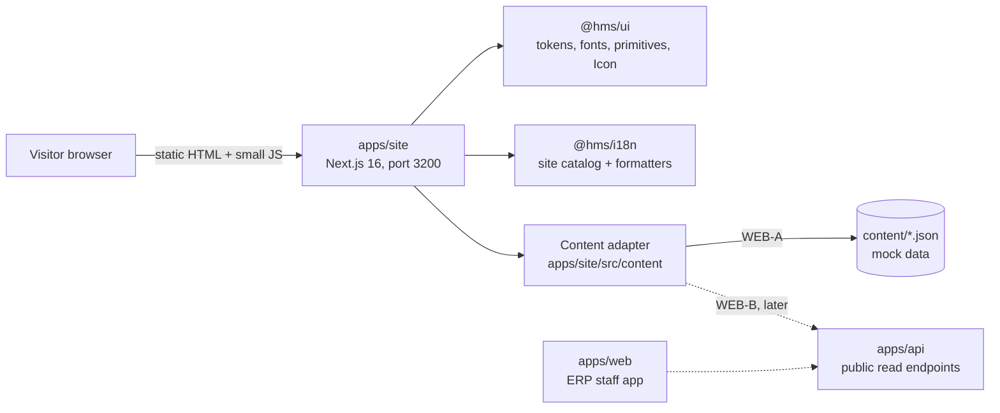
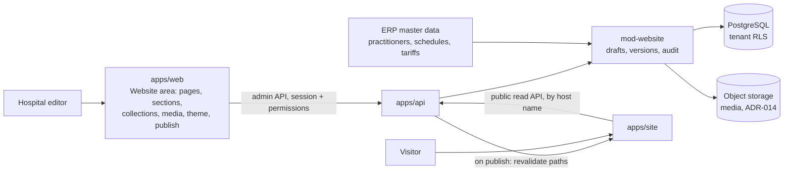

# D — System design (public website)

| Control    | Value                                                                                                                                                                                                                             |
| ---------- | --------------------------------------------------------------------------------------------------------------------------------------------------------------------------------------------------------------------------------- |
| Document   | D System design for `apps/site`                                                                                                                                                                                                   |
| Version    | 0.1.0-draft                                                                                                                                                                                                                       |
| Status     | Proposal                                                                                                                                                                                                                          |
| Owner role | Technical architect / tech lead                                                                                                                                                                                                   |
| Updated    | 2026-10-21                                                                                                                                                                                                                        |
| Related    | ERP [D](../planning/docs/D-system-design.md), [ADR-002](../planning/docs/D2-adr/ADR-002-nextjs-usage.md), [ADR-017](../planning/docs/D2-adr/ADR-017-localization.md), [ADR-022](../planning/docs/D2-adr/ADR-022-ui-foundation.md) |

## 1. Context



WEB-A has no runtime dependency on `apps/api`, the database or any external service.

## 2. Stack

Same pinned versions as `apps/web` (see `docs/STACK_VERSIONS.md`): Next.js 16.4.0 (App Router), React 19.3.0, Tailwind CSS 4.3.3, next-intl 4.14.9, TypeScript 6.0.3, Vitest, Playwright, axe. Zod (as in `@hms/contracts`) validates the mock content. No new runtime dependency is proposed for WEB-A.

## 3. Application layout

```text
apps/site/
  app/
    [locale]/
      layout.tsx            html, fonts, providers, shell
      page.tsx              home
      doctors/page.tsx, doctors/[slug]/page.tsx
      departments/..., centres/..., packages/..., tests/page.tsx
      book-appointment/page.tsx, reports/page.tsx
      patients-and-visitors/page.tsx, emergency/page.tsx
      branches/..., contact/page.tsx, articles/..., notices/page.tsx
      about/page.tsx, careers/page.tsx, portal/page.tsx
      sample-collection/page.tsx, feedback/page.tsx
      not-found.tsx
    sitemap.ts, robots.ts
    globals.css             tailwind + @hms/ui/styles.css + @source paths
  content/                  mock data in CMS format (C-070, P-040): site.json, pages/*.json, collections
  src/
    i18n/                   routing.ts, navigation.ts, request.ts
    content/                adapter interface, JSON implementation, localize()
    sections/               section registry: one renderer per section type (P-036)
    components/             shell, cards, forms (site-only)
  proxy.ts                  next-intl locale routing (Next 16 "proxy" convention)
  next.config.ts            next-intl plugin, security headers, standalone output
```

## 4. Rendering

- Every route is statically generated (P-028): `generateStaticParams` over locales x slugs; `setRequestLocale` in each layout and page so pages stay static.
- Client components only where interaction needs them: language switch, mobile menu, hero search, directory filters, package filter, test search, booking wizard, mock forms.
- No Server Actions: `'use server'` stays banned, as in `apps/web` (ADR-002).

## 5. Localization

- next-intl routing with locales `bn-BD` and `en` and URL prefixes `/bn` and `/en` (`localePrefix: { mode: 'always', prefixes: {...} }`), default `bn-BD` (P-023).
- `proxy.ts` redirects `/` and unprefixed paths to `/bn`. Browser-language and cookie detection are off (`localeDetection: false`, decided in T-WEB-01): every new visitor gets Bangla first (C-062), links stay deterministic, and the site sets no cookies.
- UI text: `siteMessages` in `packages/i18n` (P-024). Content text: `{ bn, en }` fields resolved by `localize(text, locale)` in the content adapter (P-025).
- The language switch links to the same pathname in the other locale (next-intl navigation helpers).

## 6. Content adapter (P-026)

```ts
// apps/site/src/content/index.ts (shape only)
export interface SiteContent {
  listDepartments(): Department[];
  getDepartment(slug: string): Department | undefined;
  listDoctors(filter?: DoctorFilter): Doctor[];
  getDoctor(slug: string): Doctor | undefined;
  listCentres(): Centre[];
  listPackages(category?: PackageCategory): HealthPackage[];
  listTests(filter?: TestFilter): TestPrice[];
  listBranches(): Branch[];
  listArticles(category?: string): Article[];
  listNotices(): Notice[];
  listJobs(): JobOpening[];
}
```

- WEB-A: reads the JSON files at build time, validates them with Zod (a malformed file fails the build), and returns typed objects.
- WEB-B: the same interface backed by ERP public read endpoints. Pages do not change.
- Entities and fields are defined in [E](E-content-model.md).

## 7. Boundaries and reuse (P-030, P-031)

| Rule                                                                                                                                       | How it is enforced                                               |
| ------------------------------------------------------------------------------------------------------------------------------------------ | ---------------------------------------------------------------- |
| `apps/site` imports only `@hms/ui`, `@hms/i18n`, `@hms/contracts`                                                                          | New dependency-cruiser rule `site-allowed-packages-only`         |
| No imports between apps                                                                                                                    | Existing rule `no-app-to-app`                                    |
| No raw `button`/`input`/`select`/`textarea`/`dialog`, no color literals, no `Intl.*`/`toLocale*`, icons only via `Icon`, no `'use server'` | `webGuardrails` file globs extended to `apps/site/**`            |
| Shared primitives and icons live in `packages/ui`                                                                                          | Review + lint                                                    |
| The catalog usage test scans `apps/site` for site keys                                                                                     | Extended `catalog.test.ts` (or a sibling `site-catalog.test.ts`) |

Needed `packages/ui` additions (P-031): about 36 icons for departments and contact, and `buttonClassName(variant, size)` so links can look like buttons. Possible later candidates if `apps/web` needs them too: a `Container` layout and a `Card` pattern.

## 8. Multi-tenancy (C-067)

Every hospital tenant gets its own website (C-067). WEB-A serves one demo tenant, CareSpate (C-069), but is built so that adding tenants needs no page changes:

- hospital identity (names, logo, hotlines, branches, social links) is one `SiteConfig` object (`src/config/site.ts`), never hard-coded in components;
- the content adapter interface is tenant-scoped in shape: WEB-A has a single implementation for the demo tenant; WEB-B creates the adapter per request from the resolved tenant;
- colors come only from tokens, so a tenant theme override (C-060) applies without code changes, guarded by the contrast test;
- tenant resolution in WEB-B is by host name (custom domain or `<tenant>.<platform domain>`), mapped to the ERP tenant; the hosting and domain model is Q-075;
- static generation (P-028) then becomes per tenant, or pages move to cached server rendering with revalidation; this choice is a WEB-B design task, not WEB-A.

## 9. Security

| Item                               | WEB-A setting (P-029)                                                                                                                                                                                                                                                                                       |
| ---------------------------------- | ----------------------------------------------------------------------------------------------------------------------------------------------------------------------------------------------------------------------------------------------------------------------------------------------------------- |
| Content-Security-Policy (enforced) | `default-src 'self'; script-src 'self' 'nonce-...'` or hashes as Next requires; `style-src 'self' 'unsafe-inline'` (Tailwind runtime-free, review); `img-src 'self' data:`; `font-src 'self'`; `connect-src 'self'`; `frame-ancestors 'none'`; `base-uri 'self'`; `form-action 'self'`; `object-src 'none'` |
| Other headers                      | `Referrer-Policy: strict-origin-when-cross-origin`, `X-Content-Type-Options: nosniff`, `Permissions-Policy` denying camera, microphone, geolocation; `poweredByHeader: false`                                                                                                                               |
| Storage                            | No cookies and no `localStorage` of personal data in WEB-A (lesson from R1).                                                                                                                                                                                                                                |
| Forms                              | No network submission in WEB-A (FR-WEB-GEN-006).                                                                                                                                                                                                                                                            |
| Robots                             | `noindex` while content is demo (FR-WEB-SEO-002).                                                                                                                                                                                                                                                           |

The exact CSP for Next.js inline bootstrap scripts is a spike check in T-WEB-01; the target is no `unsafe-eval` and no third-party origins.

## 10. Performance

Self-hosted fonts with unicode-range subsets are already in `@hms/ui` (C-056). Images use `next/image` with explicit sizes; placeholders are inline SVG using `currentColor` and token classes, so they cost almost nothing. Budgets in C NFR-WEB-PERF-001.

## 11. Website CMS (EP-32, WEB-B)

Requirements: [C2](C2-cms-requirements.md). Decisions: C-072, P-035..P-042.



- **Shared schemas:** site settings, navigation, every section type and every collection type are Zod schemas in `@hms/contracts`. The editor builds its forms from them, the API validates against them, and `apps/site` renders with them, so a field cannot exist in one place and not another.
- **Section registry:** `apps/site` keeps a map from section type to a React component; `apps/web` keeps a map from section type to an editor form. Adding a section type means adding a schema, a renderer and an editor form together (one task).
- **Publish flow:** editors change drafts; "Publish" validates the whole site, writes an immutable `website_version` snapshot, records an audit event and calls the site's revalidation endpoint for the changed paths (P-037, P-041).
- **Public read API:** `GET /api/v1/public/site` and per-collection endpoints return only the published snapshot for the tenant resolved from the request host; no session, no draft data, rate limited and cacheable.
- **Preview:** `apps/web` opens `apps/site` in preview mode with a short-lived signed token that lets it read the draft for that tenant only.
- **Doctor and price data:** read from ERP modules and merged with CMS public fields at publish time (P-042); the site never writes to the ERP.
- **WEB-A to WEB-B switch:** only the content adapter changes from "read JSON files" to "read published snapshot" (P-026, P-040).

## 12. Development and deploy impact

| Item                 | Change                                                                                                                                                    |
| -------------------- | --------------------------------------------------------------------------------------------------------------------------------------------------------- |
| New app              | `apps/site` (`@hms/site`), `pnpm --filter @hms/site dev` on port 3200 (P-034); included in `pnpm dev`, `build`, `lint`, `typecheck`, `test` through turbo |
| New env vars         | None in WEB-A                                                                                                                                             |
| Migrations           | None                                                                                                                                                      |
| New service / domain | None until Q-075; nothing is deployed (CLAUDE.md)                                                                                                         |
| CI                   | New app joins existing lint, typecheck, test, e2e and boundary jobs                                                                                       |
